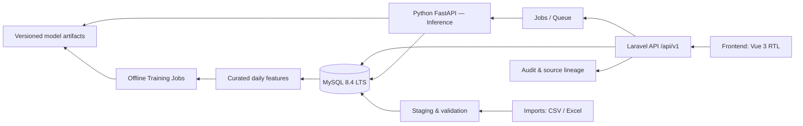

# 03 — Technical Architecture Specification

## 1. مكونات النظام

**Logical boundary:** Laravel owns identity, workflow, data validation, approvals, event semantics and persisted KPI. Python owns model training/inference/scenarios/model metadata. Frontend never trusts direct AI calls or bypasses Laravel authorization.

## 2. Deployment units

- **Web UI:** Static assets behind gateway / internal web.
- **Laravel REST API:** Auth, RBAC, data import, workflow, KPI, reporting, forecast orchestration.
- **MySQL 8.4 LTS:** OLTP normalized core, audit, immutable model/run references.
- **Queue worker:** event dispatch, import batches, reports, inference/reforecast request, retraining scheduler.
- **FastAPI:** Serving from approved serialized model package, health, prediction, diagnostics; separate offline training command or worker.
- **Object storage/filesystem:** Original upload bytes, report exports, candidate artifacts and hashes, restricted per policy.

## 3. Bounded contexts

1. `IdentityGovernance`: roles, access, approvals, audit, source metadata.
2. `MasterData`: facility, unit, shift, product, crude, energy carrier, chemical, unit conversion.
3. `Planning`: immutable target/plan versions, planned shutdowns.
4. `Production`: feed, production, readings, fuel/electricity, losses, chemical use.
5. `OperationalEvents`: status timeline, incident, downtime intervals/ETA, restart.
6. `EngineeringAnalytics`: comparison views, KPI, reconciliations, annotations.
7. `Forecasting`: run requests/results, scenarios, impact, risk.
8. `MLGovernance`: curated datasets, train/validate/promote, monitoring, drift.
9. `Reporting`: approvals, exports, scheduled reports.

## 4. Data flow and synchronous/async separation

**Write flow:** UI → Laravel Validation + RBAC → transaction to DB (and outbox) → Commit → worker handles metrics/reforecast → status displayed. Avoid remote AI call inside critical database transaction.

**Import flow:** file upload → fingerprint/scan → parse to staging rows → mapping review → warnings/errors → approve import batch → upsert canonical records with revision, commit → KPI/reforecast events. Raw uploaded file is immutable.

**Forecast flow:** command includes `as_of, product_ids, horizon, scenario_id, target_plan_version`. Laravel stores run `queued`, worker resolves point-in-time features, sends normalized payload to FastAPI, stores immutable results and artifact hashes, sets `completed`/`failed` with error summary. Retriable with idempotency.

**Retrain:** scheduled job takes approved snapshot → feature pipeline → rolling-origin backtests → compare Champion/Challenger → manual acceptance gate → publish signed artifact/version → serve after health checks. Not in API request path.

## 5. API error envelope

`{ "error": { "code": "VALIDATION_ERROR", "message": "...", "details": {...}, "request_id": "..." } }` with 400/401/403/404/409/422/429/503. Keep `409` for stale events/duplicate plan version conflicts. Schema anchored in `contracts/openapi.yaml`.

## 6. State machine for records

`draft → submitted → approved`; `submitted → rejected → draft` (editable new revision), `approved → superseded by corrected revision`. Never update approved record without retaining original values. Log activity and responsible reviewer.

**Incident:** `reported → acknowledged → investigating → resolved → closed` (supports `cancelled` under supervised correction). **Downtime interval:** `active → restart recorded → verified → finalized`. Closed interval has `actual_end > actual_start`.

## 7. Data storage and precision

- UUID primary keys proposed for interoperability; use Laravel-generated `CHAR(36)` UUIDs with ascii_bin collation, store timestamps in MySQL `DATETIME(6)` **in UTC**, and derive business date using `Africa/Tripoli`.
- Decimal metric tonnes with documented accuracy/scales; avoid floating-point for official quantity/energy accounting.
- Deduplicated `source_file_hash + sheet + source_row + source_metric + import_revision` provenance.
- MySQL `JSON` only for optional source metadata/model feature snapshot, not for all core entities. MySQL has no native PostgreSQL-style partial index; use generated nullable scope keys for partial uniqueness. Application-level row scope/RBAC is mandatory.
- Partitions/indexes only after measuring workloads; indices on `(unit_id, date)`, `(product_id,date)`, `(event_id,changed_at)`, `(forecast_id)`, `(status)`.

## 8. Fault-tolerance rules

- Queue down: API still records actuals/events; mark pending recalculation; retry safely.
- FastAPI down/model unavailable: respond `forecast_unavailable`, keep previous forecast explicitly `stale` with as_of; never silently replace with invented figures.
- Import parse failure: preserve original file + staging errors; no half-approved canonical write.
- Duplicate event webhook: same idempotency key returns existing event ID; no duplicate downtime.
- Stale ETA edit: optimistic concurrency conflict, prompt user to refresh rather than overwrite silently.

## 9. Observability & audit

`trace_id`, `import_batch_id`, `event_id`, `forecast_run_id`, `training_run_id`, `artifact_sha256`, `plan_version_id`. Collect count of failures/latency/freshness; don't log secrets/complete confidential record dumps.

## 10. Threat model and assumptions

Threats: privilege escalation, tampering with actual data, poisoning imported data, malicious Excel formulas/CSV injection, replaying event requests, leaking source PDFs, model artifact replacement, compromise via future OT connector. Controls: RBAC, validation, audit+hash, upload sanitization, encryption, signed artifact registry, network boundaries and OT isolation.

## 11. Open decisions

Exact runtime versions, queue engine (DB/Redis), production topology, source retention, TLS/internal SSO, asset hierarchy, report mapping and acceptable latency require approval in `planning/DECISIONS.md`.

## 12. MySQL database requirements

- MySQL **8.4 LTS**, InnoDB, `utf8mb4`, `STRICT_TRANS_TABLES`; Laravel `DB_CONNECTION=mysql`.
- Migrations are authoritative. `contracts/schema.sql` is a MySQL reference only; never execute against production.
- `CHAR(36) ascii_bin` app-created UUIDs, UTC `DATETIME(6)`, Decimal units, `JSON`.
- Use transactions + `lockForUpdate()` or version checks for approvals, model active-version swapping and event ETA transitions.
- `status='active'` model uniqueness across `product × granularity × horizon` must be enforced with generated unique scope key, not a partial unique index.
- Use application scopes and authorization policies; MySQL lacks PostgreSQL native Row Level Security.
- For data integrity, implement source-import idempotency and generated nullable-scope keys; test under concurrent requests.
