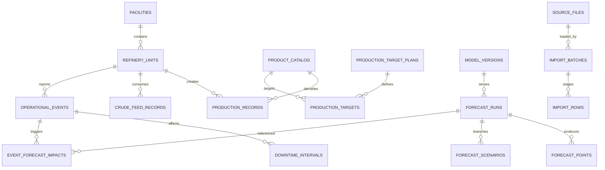

# 04 — Data Model + Domain Dictionary

> **Implementation note (IDPS v1.1):** Entity groups here describe the intended extended domain. `contracts/schema.sql` contains **44 preliminary MySQL reference tables**, not every entity named in this glossary (e.g., some blending/lab/shift structures are proposed extensions). The coding agent must reconcile these lists, explicitly scope migrations per ticket, and never claim all listed entities are already implemented.

## Entity groups

### Identity & provenance

`users`, `roles`, `permissions`, `user_roles`, `audit_logs`, `source_files`, `import_batches`, `import_rows`, `record_revisions`, `approval_actions`.

### Reference & planning

`facilities`, `refinery_units`, `product_catalog`, `crude_catalog`, `chemicals`, `energy_carriers`, `measurement_units`, `shifts`, `production_target_plans`, `production_targets`, `planned_shutdowns`.

### Actual and events

`crude_feed_records`, `production_records`, `unit_status_intervals`, `operational_events`, `event_revisions`, `downtime_intervals`, `energy_consumptions`, `loss_records`, `chemical_consumptions`, `blend_batches`, `blend_components`, `laboratory_samples`.

### Analytics / AI

`kpi_definitions`, `kpi_results`, `reconciliation_cases`, `dataset_snapshots`, `model_versions`, `training_runs`, `forecast_runs`, `forecast_points`, `forecast_scenarios`, `event_forecast_impacts`, `model_monitoring_metrics`, `alerts`.

## Main relationships

## Core record requirements

| Field | Applies to | Meaning |
|---|---|---|
| `facility_id/unit_id` | operational records | أين حدث القياس، unit vs aggregate facility |
| `business_date` | daily/shift records | يوم العمل المحلي مع timezone |
| `observed_at` | readings | وقت الملاحظة الفعلي |
| `recorded_at` | all | متى وصل النظام |
| `available_at` | feature sources | أول وقت تصبح المعلومة متاحة لتوقع مرجعي |
| `source_file_id/source_reference` | imported | اسم/sha/sheet/row/page/cell |
| `quantity` | feed, production etc. | رقم decimal مع unit_id |
| `status/version` | approved records | دورة اعتماد ولا تعديل صامت |
| `correction_reason/replaces_id` | corrections | سبب والتاريخية الأصلية |

## Reference dimensions

- Product roles: `intermediate_stream`, `final_product`, `blend_additive`, `byproduct`, `fuel`, `waste` (قرار مهندسي المصافي).
- Product examples confirmed by monthly report: LPG، نافثا غير معالجة، جازولين، كيروسين، زيت ديزل، زيت وقود ثقيل، إسفلت، ديزل خوائي (بوحدة الإسفلت)، إضافات MTBE.
- Crude names verified in sources include الشرارة والحمادة. Do not assume other listed workbook crude categories had volume in every month.
- Units: metric tonne, kilogram, liter, kWh, GJ, hour, day, `%`. Barrel conversions require oil density and temperature basis documented by owner.

## Temporal model for planned vs unplanned events

- `planned_shutdowns`: planned start/end, `known_at`, approval version, asset scope, calendar snapshot.
- `operational_events`: `detected_at`, `reported_at`, `effective_at`, `event_kind`, classification, source, current status, `external_event_key`.
- `downtime_intervals`: start/actual_end/expected_end, status, event_id/unit_id; downtime aggregation uses union of intervals per unit to prevent overcounting.
- `event_revisions`: ETA/plan updates, actor/reason, revision number; `as_of` snapshot for reproducibility.

## Approved measurement dimensions

**Crude processed:** mass of crude feed processed, preferably for a stated unit/time frame, not synonymous with refinery product totals.

**Produced:** mass per product/grade/stage and period, with clear treatment of internally recycled product, finished blended product, and throughput duplicated between units.

**Energy:** fuel mass and power are distinct physical units. GJ/t requires energy factors, lower/higher heating value basis and electricity equivalent factor approval. Do not add tons of fuel to kWh.

**Loss:** explicitly distinguish `unaccounted_balance_loss` from `flared/loss_to_flare`, `vent`, `measurement_uncertainty`, `total_loss_and_fuel`; source PDF uses multiple contexts. Define report and aggregation scope with process engineer.

## Operational rules for data correction

Corrections create immutable superseding records; KPI generation points to `approved_snapshot_id`, not the latest mutating table view. Forecast must store actual available-at sources and plan version at inference time. If source historical data is corrected, schedule re-derived KPI/retrain only after approval; maintain comparison with previous versions.

## Canonical SQL

`contracts/schema.sql` is a **reference minimum scaffold**, not complete production migration. Laravel migrations must implement the approved relationships, column constraints, unique keys and indexes, plus unit tests. Do not run schema against refinery production data without acceptance.
