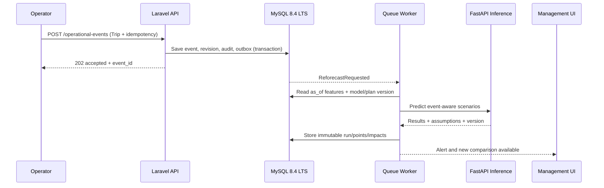

# 07 — Event-aware Shutdown & Dynamic Reforecasting Specification

## Core distinction

1. **Planned Shutdown:** prospectively registered and approved; enters known-future plan features at/after `known_at`.
2. **Unplanned Shutdown:** unanticipated Trip/Failure; model cannot know it before the fact. Once observed or reported it triggers **reforecast**, not retroactive rewriting.
3. **Failure Prediction:** separate Predictive Maintenance scope requiring sufficient sensor historian and labeled equipment failures; not part of this project MVP.

## Shutdown lifecycle and actors

```text
Planning creates Planned Window      Operator reports Unplanned Trip
             │                               │
        approval/version                idempotent intake
             └───────────────┬───────────────┘
                             ▼
                        Event timeline
                             │
                     Assign affected units
                             │
                  ETA known? Yes / No
                     ┌───────┴────────┐
                     │                │
                 Confirmed ETA    Unknown ETA
                     │           scenario bounds
                     └───────┬────────┘
                             ▼
                       Reforecast job
                             │
                  Before/after comparison
                             │
                Alert/acknowledge/annotation
                             │
                Restart/actual end/reconcile
                             │
                        Final event
```

## Required event fields

`event_id`, `kind` (planned/unplanned), `event_type` (trip/startup/feed_reduction/utility_failure/maintenance...), `unit_id`, `status`, `started_at`, `detected_at`, `reported_at`, `known_at`, `expected_end_at` nullable, `actual_end_at` nullable, `source`, `external_event_key`/idempotency_key, `reason_code`, `severity`, `created_by`, `approved_by`, `revision`, `notes`.

**Interval rules:** `actual_end > start`, expected ETA may be changed with revision, open interval clips to current as_of when counting **known elapsed downtime**, future planned downtime is separate, overlapping intervals for same unit use union rather than sum. Partial feed reduction uses `derating_factor` (not equal to full shutdown).

## Use Cases

### UC-S01 — register planned downtime

- Planning defines unit, planned start/end, outage class, optional affected streams, reason, known_at.
- Reviewer approves plan version.
- Forecast job uses only plan known by as_of, so editing a plan today cannot rewrite historical features from yesterday.
- Changing calendar produces new plan version and may reforecast open horizon.

### UC-S02 — register unplanned trip

- Authorized production user/approved read-only signal creates Trip event with actual/observed time.
- API validates unique external key, unit, no unapproved backdating; stores event and audit/outbox transactionally.
- UI shows `unit_state=tripped` and `reforecast_pending` rather than a fake final prediction.
- Worker retrieves latest approved features, actuals-to-date, active plan and model; writes new run `parent_run_id`.
- Compare same horizon/product/plan. Notify operators/process engineers of predicted difference; explicitly note if plan changed, making comparison not strictly event-only.

### UC-S03 — unknown restart time

- `expected_end_at = null` remains genuinely unknown.
- User/procedure selects scenario bounds: restart after 12h, 48h or 120h **only if accepted by process owner**; these are illustrative defaults, not sourced facts.
- System reports per-scenario outputs; no central estimate without defensible prior or operator assumption.
- On ETA update, scenarios are superseded but stored. New reforecast run.

### UC-S04 — restart and recovery

- Operator records actual restart, verifies status and timeframe.
- Reconcile overlapping intervals, finalize actual lost hours, actual production for interval when data approved.
- Trigger reforecast for remainder of period and preserve original baseline and trip-era estimates.
- Difference between before and after forecast is **change in model estimate**, not observed actual loss.

### UC-S05 — missed event entry

- Optional future monitoring of `feed_rate ≈ 0`, `status=OFF` or sharp anomaly flags `suspected_shutdown`, subject to approved threshold/time debouncing, sends verification alert.
- Not automatically treated as confirmed Trip until reviewed; failures of sensor feed may look like stopped production.

## Incident → forecast orchestration



## Accuracy and operational limits

- Reforecast is run **after** event knowledge; cannot foresee unforeseen outages.
- If only monthly data are available, expected effect is estimated through a bounded, explicitly assumption-based calculator, not passed off as ML forecast.
- A unit event can affect multiple products and downstream processes nonlinearly; never simply apply fixed `% lost per hour` as if verified unless signed process model/calibrated historical evidence.
- Missing restart ETA → range scenarios and quality badge `assumption_heavy`.
- Model unavailable → event is still recorded; reforecast marked unavailable/stale.

## Acceptance tests

1. Planned shutdown added at prior date → forecast uses only allowed plan version.
2. Unexpected trip at 14:35 → same event repeated does not duplicate downtime; new run holds parent_run_id.
3. ETA null → three labeled scenarios with assumptions and boundaries; no false exact guarantee.
4. ETA changed to earlier and later dates → new immutable run, original unchanged.
5. Restart time changes availability and records actual elapsed time without negative/out-of-bound intervals.
6. Two overlapping unit trips → no double counted unavailable hours.
7. UTC boundary/DST/local date handling tested with facility timezone.
8. AI outage → actual recording unaffected; user sees `forecast unavailable`.
9. Unapproved retroactive event cannot leak into past feature snapshot.
10. Event impact differences carry matching horizon and target scope, else mark incomparable.
