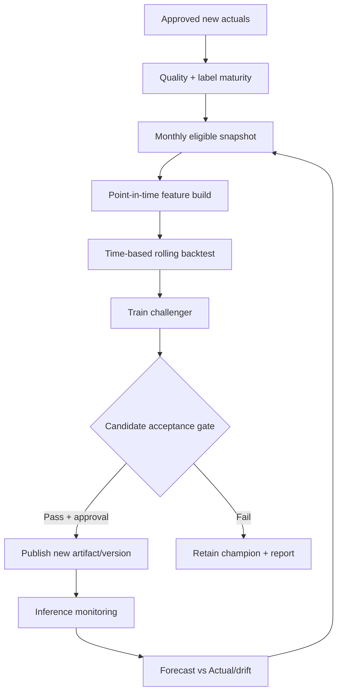

# 13 — MLOps-lite: Continuous Evaluation, Retraining and Model Governance

## Concept

Initial training on historical **approved daily** records for 3 years *if supplied*. New observed, approved daily production is appended to curated history, compared with prior predictions, then models are **periodically retrained** rather than adjusted blindly on each record. XGBoost tree models do not natively use reliable generic `partial_fit` online learning; retrain from snapshot as default.

## Core process

## Data eligibility

- Record must be `approved`, target label observed, unique, correct granularity, correct scope and unit.
- Data corrections are handled through revised training snapshot with lineage.
- Calibration and evaluation windows are sealed and captured in manifest, code commit and version hash.
- New records do not enter deployed model until scheduled retraining and promotion.

## Model registry fields

`model_id, product_id, artifact_uri, artifact_sha256, architecture, hyperparams, feature_schema_version, training_snapshot_sha256, training_start/end, validation_window, test_window, metrics_by_regime_json, approval_status, trained_by, approved_by, active_from, supersedes_model_id, rollback_reason`.

## Champion–Challenger gate

- Challenger **must** pass reproducibility/integrity checks.
- Evaluate same sealed temporal windows and target/horizon as Champion and Naive baseline.
- Require acceptable primary error (WAPE/MAE), no severe degradation in shutdown subset, no negative outputs without clipping policy, and operational sanity review.
- If statistically or practically inconclusive, keep Champion and request more data.
- Promotion always creates immutable signed deployment event. Rollback does not delete artifact/history.

## Monitoring

- Data freshness delay; missingness; input distributions; scope changes; source revisions.
- MAE, RMSE, WAPE overall and per product, by shutdown regime and horizon.
- Drift: configurable PSI/KS or comparable distribution checks, with caveats on small samples.
- Forecast performance drops: alert only after adequate approved actuals; don't alarm from 1 sample.
- Scenario actual vs planned data to assess ETA assumptions; not equivalent to predicting a Trip beforehand.

## Retraining cadence & fallbacks

**Initial schedule:** monthly after closure/approval of data; change cadence when justified by drift/time/operational need. User/admin must be able to pause retraining. If insufficient newly approved rows, skip and record `insufficient_training_data` rather than pretend improved learning.

**Serving fallback:** approved Champion first; if unavailable mark `forecast_unavailable` or `last_forecast_stale`. No silent unvalidated fallback model with altered behavior.

## Rollback and security

Model file is checked by checksum and signature where infrastructure allows; verify expected feature schema and product scope. Restrict artifact write and promotion. Rollback is explicit, audited and smoke-tested.
